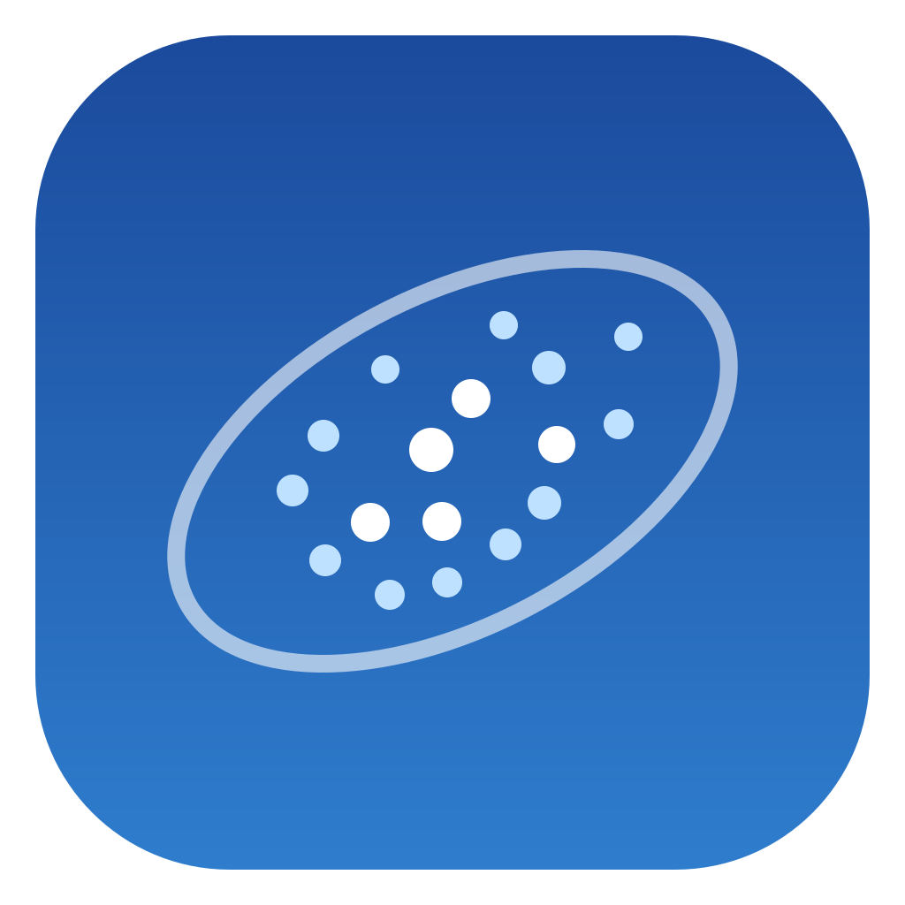
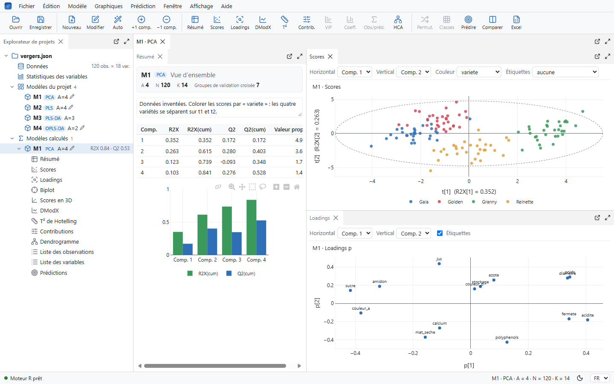
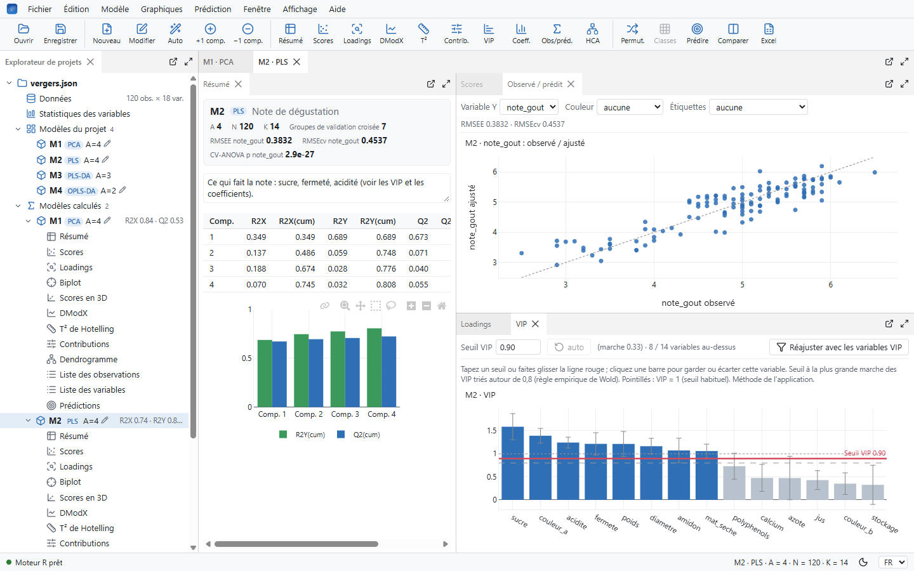
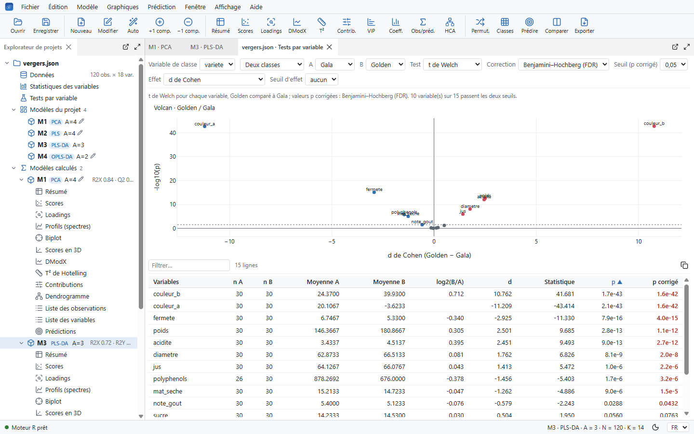
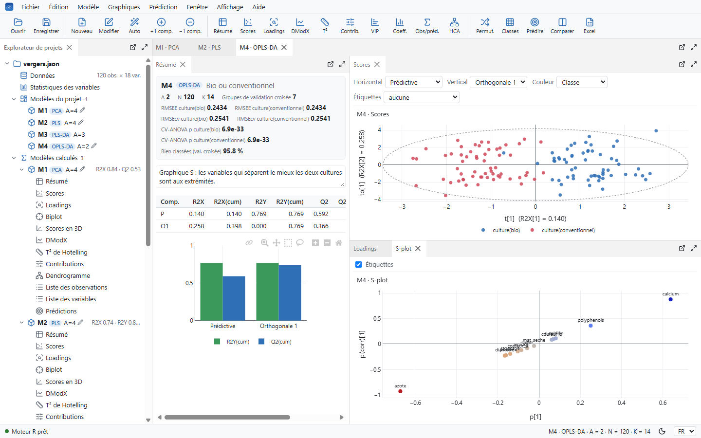
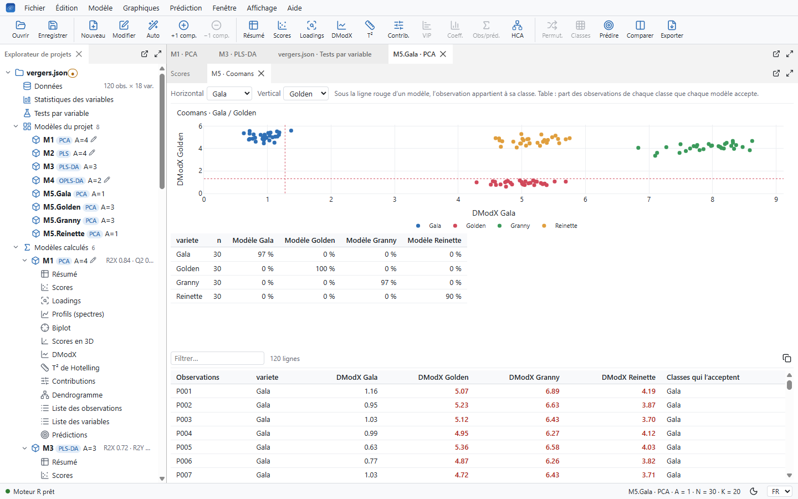
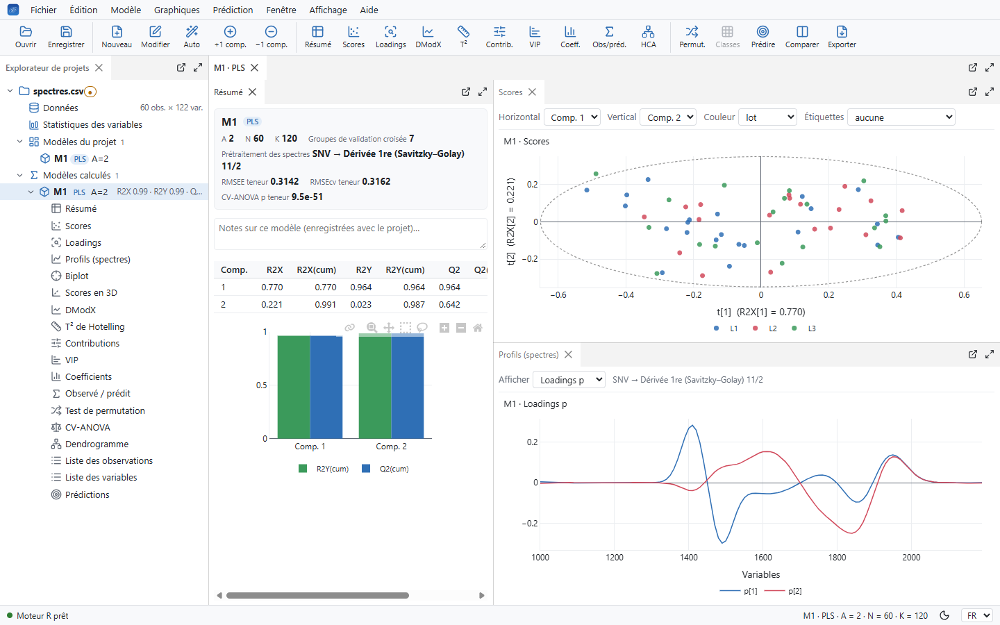
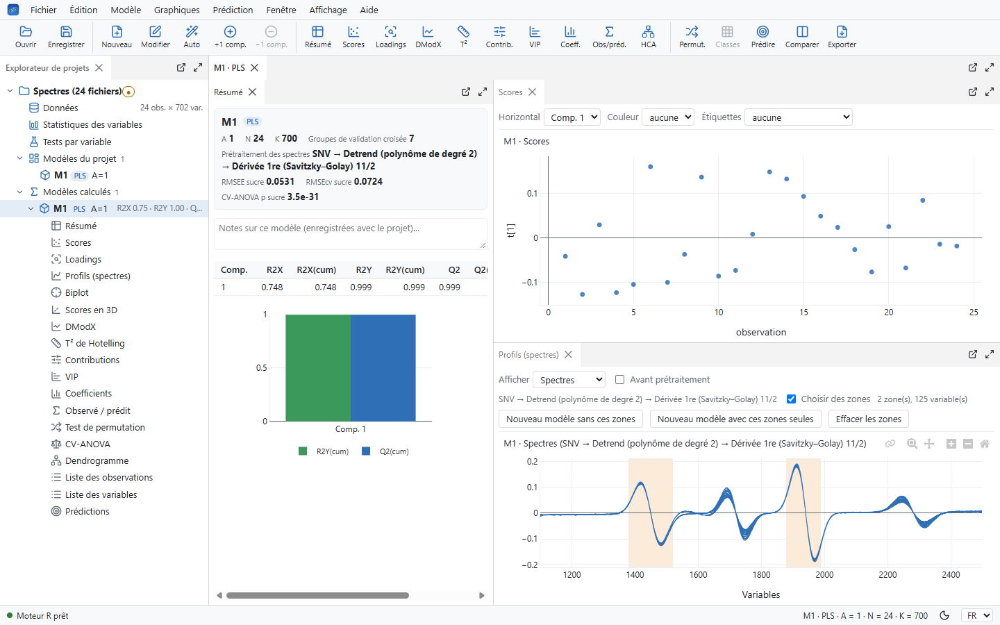
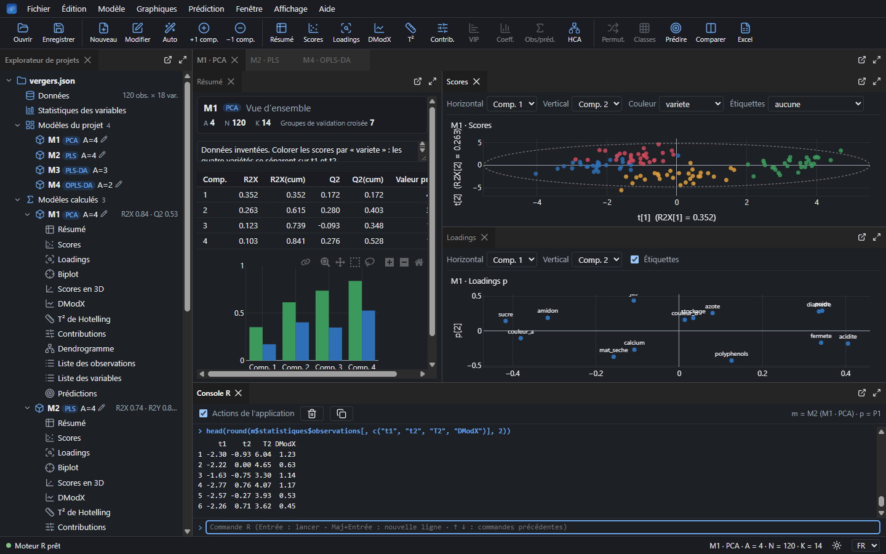

<h1 align="center">Nuée</h1>

<a href="README.md">English</a> · <b>Français</b>

  <b>ACP, PLS, PLS-DA et OPLS sous Windows et Linux, calculées en R.</b> 
  Des graphiques interactifs, des modèles côte à côte, et chaque calcul lisible.

  
  
  
  
  

Nuée est une application de bureau pour l'analyse multivariée. Ouvrez un tableau venant
d'Excel, de R, de SPSS, de Stata, de SAS ou de jamovi (ou collez-le), choisissez vos
variables, et obtenez le modèle avec ses scores, ses loadings, ses diagnostics et sa
validation, dans des graphiques où l'on zoome, sélectionne et colore. Renvoyez les données et
les résultats vers chacun de ces logiciels, prenez le paragraphe de votre section Méthodes, ou
exportez un script ou un rapport R Markdown / Quarto qui refait le modèle avec R seul, sans
Nuée. Chaque calcul est écrit en R, commenté, pour vérifier exactement ce qui a été calculé, et
le modifier.

L'interface est en français et en anglais (*Affichage › Langue*) ; les captures la montrent en
français.

## Installer

### Windows

1. Téléchargez `Nuee-Setup-<version>.exe` depuis la page [Releases](https://github.com/4rtefakt/nuee/releases).
2. Lancez-le et choisissez de l'installer pour vous seul (sans droits d'administrateur) ou pour
   tous les utilisateurs de l'ordinateur.
3. Windows peut dire qu'il a protégé votre ordinateur, car l'installateur n'est pas signé :
   cliquez sur *Informations complémentaires*, puis *Exécuter quand même*.

R est inclus : il n'y a rien d'autre à installer. Nuée apparaît dans le menu Démarrer, et se
désinstalle depuis *Paramètres › Applications*. Vos projets restent là où vous les avez
enregistrés.

Au démarrage, Nuée demande à GitHub s'il existe une nouvelle version (rien d'autre n'est
envoyé). S'il y en a une, un clic dans la barre d'état télécharge son programme d'installation,
vérifie son empreinte SHA-256 auprès de GitHub, propose d'enregistrer vos projets, l'installe
et redémarre Nuée. *Aide › Chercher une nouvelle version au démarrage* arrête la recherche.

### Linux

Sous Linux, Nuée utilise le R installé sur l'ordinateur (une version de R dépend des
bibliothèques de sa distribution : elle ne peut pas être emportée comme sous Windows).

- **Debian, Ubuntu et dérivées :** téléchargez `Nuee-<version>-amd64.deb` depuis la page
  [Releases](https://github.com/4rtefakt/nuee/releases) et installez-le avec
  `sudo apt install ./Nuee-<version>-amd64.deb`. apt installe aussi R et les paquets R dont
  Nuée a besoin. Nuée apparaît dans le menu des applications.
- **Autres distributions :** `Nuee-<version>-x86_64.AppImage` (le rendre exécutable, puis le
  lancer) ou `Nuee-<version>-x64.tar.gz` (le décompresser, puis lancer `./nuee`). Installez
  d'abord R depuis votre distribution, puis les paquets, dans R :
  `install.packages(c("httpuv", "jsonlite", "openxlsx", "haven", "readxl"))`.

Les projets `.usp` demandent `python3`. Nuée cherche `Rscript` dans le `PATH`, puis dans
`/usr/local/bin`, `/usr/bin` et `/opt/R/<version>/bin` ; lancez-le avec
`RSCRIPT=/chemin/vers/Rscript` pour un autre R. Les réglages sont dans `~/.config/Nuee`.

## Premiers pas

- **Essayer l'exemple :** *Aide › Projet d'exemple* ouvre 120 pommes inventées (quatre
  variétés, bio ou conventionnelles, une douzaine de mesures et une note de dégustation) avec
  quatre modèles prêts : une ACP, une PLS de la note, une PLS-DA des variétés et une OPLS-DA du
  mode de culture.
- **Ouvrir vos données :** *Fichier › Ouvrir* (Ctrl+O) lit un tableau, une ligne par
  observation et les noms des observations dans la première colonne (voir [Fichiers](#fichiers)
  pour les formats), ou *Fichier › Coller un tableau* (Ctrl+V) prend des cellules copiées
  dans n'importe quel tableur, ou déposez des fichiers sur la fenêtre. Les colonnes de texte et
  les facteurs deviennent des variables qualitatives, pour colorer ou comme classes.
- **Faire un modèle :** *Modèle › Nouveau modèle* (Ctrl+N) : le type, le rôle de chaque variable
  (X, Y ou écartée), l'échelle et la transformation, les observations retenues. Le nombre de
  composantes est choisi par validation croisée, sauf si vous le fixez.
- **Explorer :** chaque modèle a sa page avec son résumé, ses scores et ses loadings ; ajoutez
  toute autre vue depuis le menu *Graphiques*. Sélectionnez des points avec un cadre ou un
  lasso : la sélection vous suit dans chaque graphique du modèle.

Le guide complet est fourni avec l'application (*Aide › Guide d'utilisation › Guide complet*),
en français ([LISEZ-MOI-APPLICATION.txt](LISEZ-MOI-APPLICATION.txt)) et en anglais
([USER-GUIDE.txt](USER-GUIDE.txt)).

## Ce qu'elle fait

**Méthodes :** ACP, PLS, PLS-DA, et OPLS / OPLS-DA (plusieurs Y ou plus de deux classes donnent
plusieurs composantes prédictives), avec les valeurs manquantes traitées par NIPALS et une
validation croisée en 7 groupes (R2, Q2, et Q2 par variable). Modèles de classe : une ACP par
classe, et le graphique de Coomans pour dire à quelle classe appartient une observation, à
plusieurs, ou à aucune.

**Validation :** tests de permutation, CV-ANOVA, tables de classement et courbes ROC de la
PLS-DA, intervalles de confiance par jack-knife. Un jeu de test laissé hors du modèle et de la
validation croisée (choisi à la main, au hasard ou par Kennard–Stone, par classe pour une
PLS-DA), puis prédit : RMSEP, biais, SEP et Q2 externe, ou son classement.

**Variables :** VIP avec un seuil placé automatiquement (ou déplacé à la main), coefficients,
loadings, biplot, réajustement avec les seules variables retenues. Statistiques des variables
avec les transformations log proposées, histogrammes et carte des valeurs manquantes. Tests par
variable entre deux classes (t de Welch ou de Student, Mann–Whitney) ou entre toutes (ANOVA,
Kruskal–Wallis), avec la correction de Benjamini–Hochberg et un graphique volcan.

**Observations :** scores en 2D et en 3D, T2 de Hotelling et DModX avec leurs limites,
graphiques de contributions qui expliquent pourquoi une observation se démarque,
classification hiérarchique sur les scores, classes faites d'une sélection.

**Spectres :** ouvrez des fichiers JCAMP-DX, SPC (Galactic, Thermo) ou texte, un spectre par
fichier ou plusieurs, avec un tableau d'informations sur les échantillons (teneurs, classes)
joint par le nom des fichiers. SNV, MSC, detrend, retrait de la ligne de base et lissage ou
dérivées de Savitzky–Golay avant le modèle. Loadings, coefficients, VIP ou les spectres
eux-mêmes en lignes selon la longueur d'onde ; faites glisser dessus pour laisser des zones de
longueurs d'onde hors d'un nouveau modèle, ou pour ne garder qu'elles.

**Prédiction :** appliquez un modèle à de nouvelles observations venant d'un tableau, avec un
signal pour celles hors du domaine du modèle, et exportez les résultats.

**Votre travail :**
- enregistrer un projet (`.nuee`, qui ouvre Nuée d'un double-clic) garde ses modèles, la
  disposition de vos panneaux, les réglages des graphiques et les sélections ;
- une copie de secours toutes les deux minutes, proposée après une panne, et l'annulation des
  modifications des données ;
- des notes sur chaque modèle ;
- la modification des données et de nouvelles variables par des formules R ou des classes de
  valeurs ;
- plusieurs fenêtres, et des vues qui se détachent sur un second écran ;
- des graphiques mis en forme pour une publication (polices, palettes, taille) et exportés en
  PNG ou SVG ;
- un rapport du modèle en PDF ou Word ;
- le paragraphe d'une section Méthodes, écrit d'après le modèle en français ou en anglais, avec
  ses références (*Modèle › Texte pour la section Méthodes*).

## Fichiers

| | Ouvre | Exporte |
|---|---|---|
| Excel | `.xlsx`, `.xlsm`, `.xls` (feuille au choix) | `.xlsx` (une feuille par tableau) |
| Texte | `.csv`, `.txt`, `.tsv` : séparateur, virgule décimale et encodage reconnus | `.csv`, `.tsv` |
| R | `.rds`, `.RData` (tableau au choix ; facteurs et noms des lignes gardés) | `.rds`, `.RData` |
| SPSS | `.sav`, `.zsav`, `.por` (les étiquettes de valeurs deviennent des catégories) | `.sav` |
| Stata | `.dta` | `.dta` |
| SAS | `.sas7bdat`, `.xpt` | `.xpt` |
| jamovi | `.omv` | `.omv` |
| dBase, Weka | `.dbf`, `.arff` | `.dbf`, `.arff` |
| Spectres | `.jdx`, `.dx`, `.jcm` (JCAMP-DX), `.spc` (Galactic, Thermo), ou texte avec une colonne par spectre ; plusieurs fichiers à la fois avec *Fichier › Importer des spectres* | |
| Presse-papiers | des cellules copiées depuis Excel, LibreOffice, Google Sheets, jamovi… | |

*Fichier › Exporter les données* écrit le tableau du projet ; *Fichier › Exporter les résultats
du modèle* (Ctrl+E) écrit les observations (scores, T2, DModX, valeurs ajustées), les variables
(loadings, VIP), les composantes et les coefficients. Pour SPSS, Stata et SAS, les noms des
variables sont rendus valides et le nom d'origine devient l'étiquette de la variable. Les
fichiers SAS sont au format de transport version 5, que SAS lit avec `libname xport` ; les
fichiers dBase sont en Windows-1252, comme l'attendent LibreOffice et les logiciels de SIG. Les
fichiers exportés ont été ouverts dans jamovi, PSPP (pour SPSS), Weka, LibreOffice et pandas
(pour Stata et SAS). Les lecteurs de spectres ont été vérifiés sur les fichiers d'essai
officiels de JCAMP-DX (toutes les écritures compressées) et sur les fichiers d'exemple SPC
habituels.

## R de bout en bout

Le moteur est du R dans [`moteur/R/`](moteur/R), commenté en français : prétraitement, NIPALS,
validation croisée, statistiques, prédiction. Aucune statistique n'est calculée ailleurs.

- **Console R** (*Affichage › Console R*, Ctrl+J) : le code R derrière chaque action, et votre
  propre code exécuté dans la session de l'application, avec `m` et `p` pour le modèle et le
  projet affichés.
- **Exporter vers R** (*Fichier › Exporter vers R*) : tout modèle devient un script, ou un
  rapport R Markdown ou Quarto, qui le refait sans Nuée. Il contient les données (ou les lit dans
  un CSV à côté), le code des fonctions du moteur dont le modèle a besoin, copié avec ses
  commentaires, et le modèle ; il vérifie la version de R et les paquets dont il a besoin. Le
  rapport ajoute le texte des méthodes, des tableaux, des graphiques et les références, et se
  compile dans RStudio (*Knit*) ou avec Quarto. En plus, au choix : un `renv.lock`, les données
  et le modèle ajusté en `.RData`, et un projet RStudio. Avant d'écrire, Nuée refait le modèle du
  script et vérifie qu'il donne les mêmes résultats.
- **Le corriger soi-même :** modifiez un fichier du moteur, tapez `recharger_moteur()` dans la
  console, et réajustez.

## Ouvrir des projets `.usp`

Nuée ouvre aussi les fichiers de projet `.usp` : leurs données, les modèles qu'ils contiennent
et les valeurs avec lesquelles ces modèles ont été enregistrés. Il recalcule chaque modèle en R
et marque chaque valeur du résumé comme identique, proche ou différente. Sur 944 modèles de 133
projets, R2X, R2Y, le Q2 des PLS, les scores, les loadings, T2, DModX, les VIP et les
coefficients sont ceux enregistrés, à quelques modèles avec données manquantes près ;
*Aide › Résultats et écarts connus* liste les écarts connus.

## Citer Nuée

*Modèle › Texte pour la section Méthodes* cite Nuée et les méthodes pour vous. Sinon :

> 4rtefakt (2026). Nuée (version 1.0.0) [Computer software]. https://github.com/4rtefakt/nuee

Le bouton *Cite this repository* de GitHub la donne dans d'autres formats
([CITATION.cff](CITATION.cff)). Ce qui a changé à chaque version : [CHANGELOG.md](CHANGELOG.md)
(en anglais ; dans l'application, *Aide › Quoi de neuf*).

## Construire depuis les sources

Voir [docs/developpement.md](docs/developpement.md) (en anglais) : lancer depuis les sources,
la construction (installateur et version pour un partage réseau), les vérifications, et la
façon dont les résultats ont été comparés. Les vérifications tournent sur GitHub à chaque envoi
et chaque pull request.

## Licence

Nuée est un logiciel libre sous la [Licence publique générale GNU v3.0](LICENSE) ou
ultérieure.

L'installateur inclut R (GPL-2 | GPL-3) avec ses paquets recommandés et les paquets R httpuv,
jsonlite, openxlsx, haven, readxl et leurs dépendances, Electron (MIT), Plotly.js (MIT),
dockview (MIT) et les icônes Lucide (ISC), chacun sous sa propre licence.
