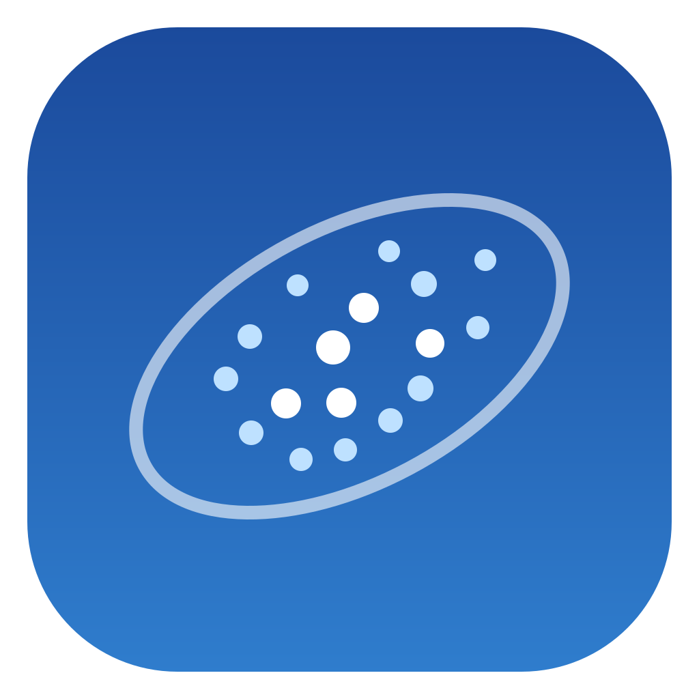
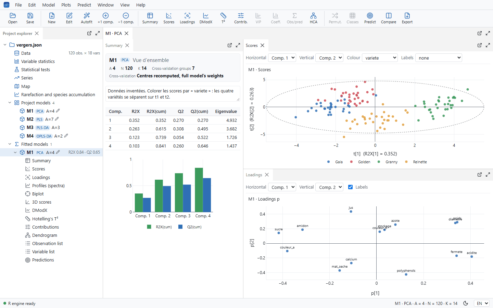
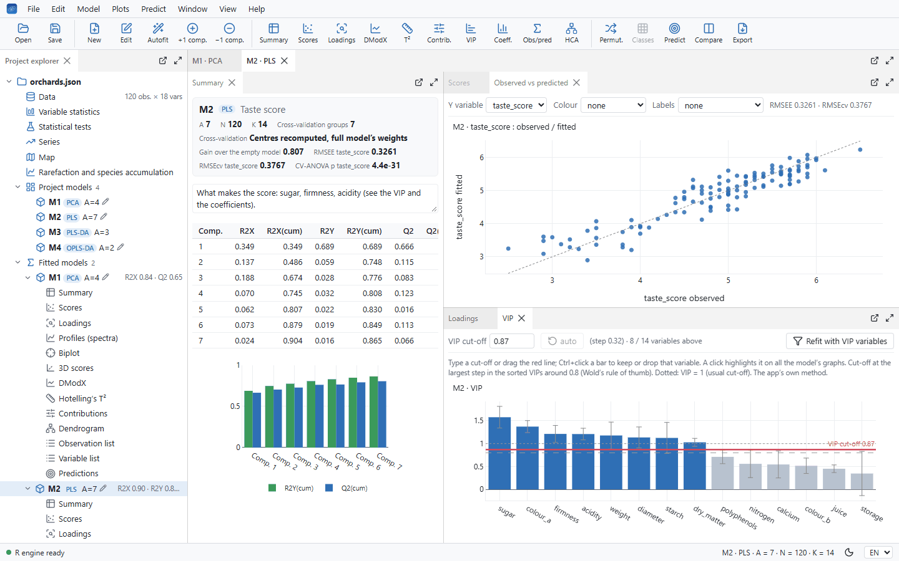
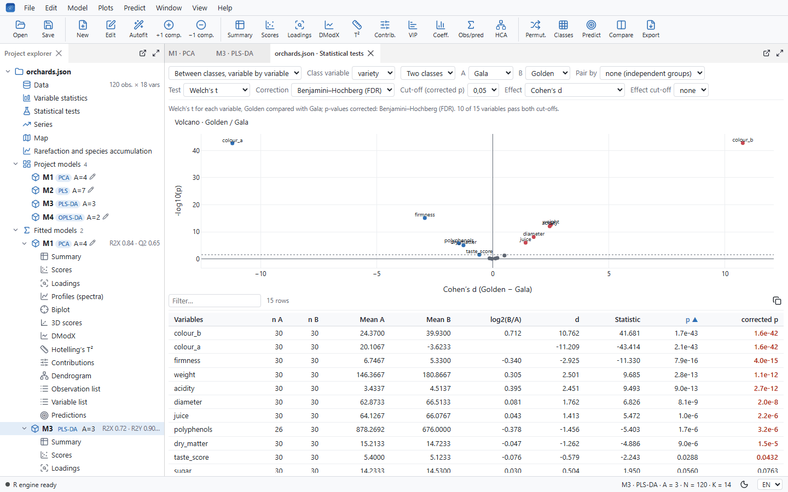
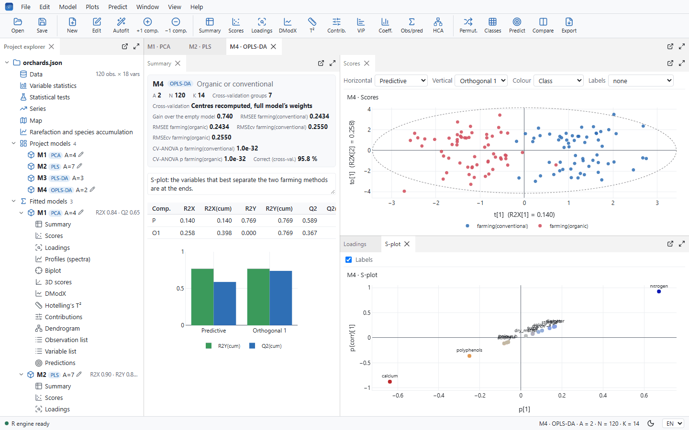
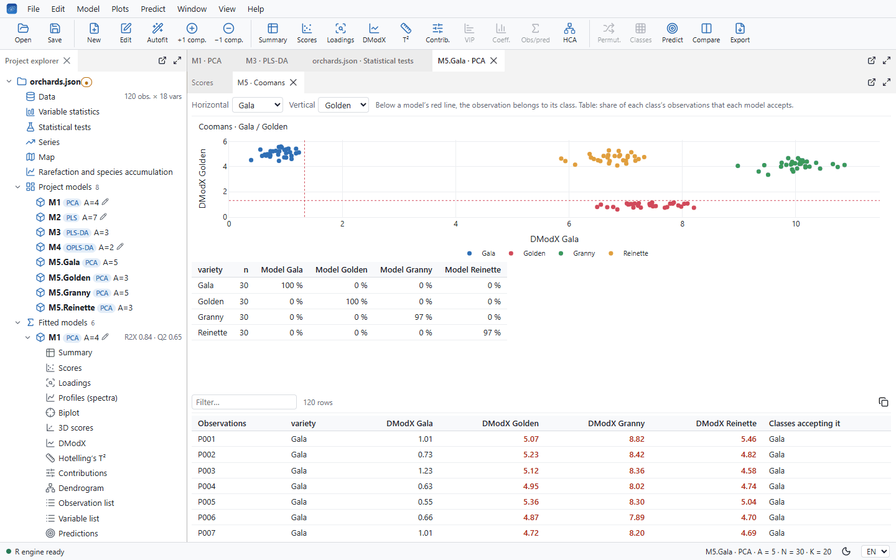
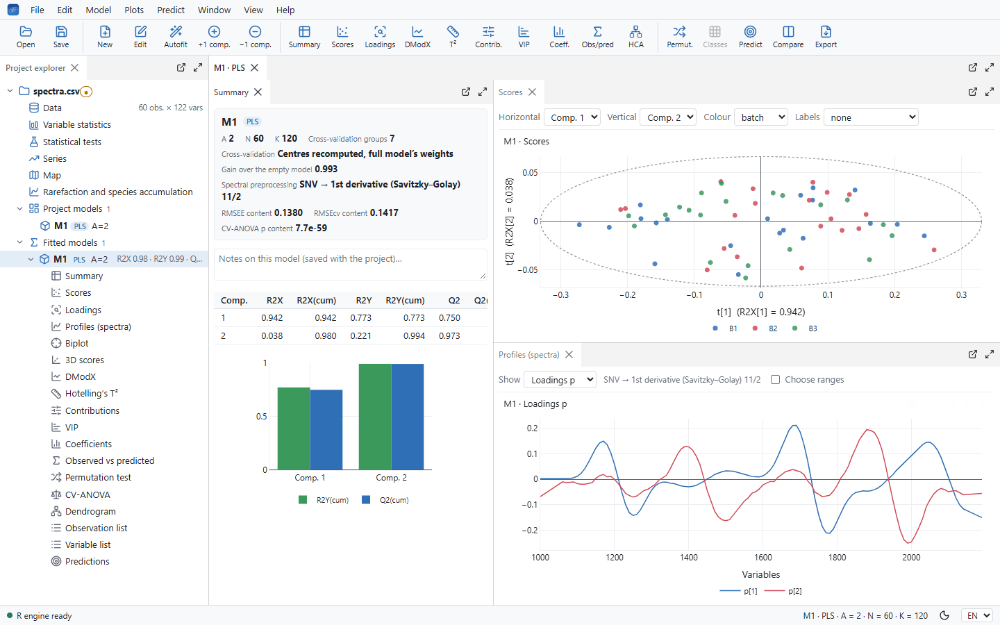
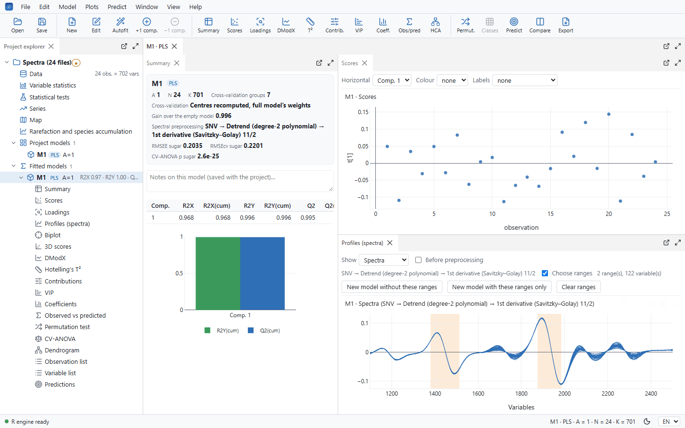
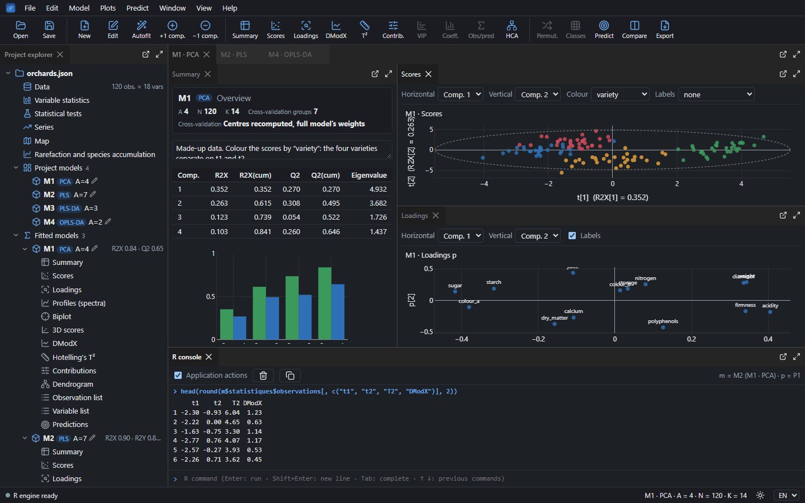

<h1 align="center">Nuée</h1>

<b>English</b> · <a href="README.fr.md">Français</a>

  <b>PCA, PLS, community ecology, mixed models and maps on Windows, macOS and Linux, computed in plain R.</b> 
  Interactive plots, models side by side, and every calculation open to read.

  
  
  
  
  
  
  

Nuée (French for *swarm*) is a desktop application for multivariate data analysis. Open a
table from Excel, R, SPSS, Stata, SAS or jamovi (or paste one), pick your variables, and get
the model with its scores, loadings, diagnostics and validation, in plots you can zoom, select
and colour. Send the data and the results back to any of those programs, take the paragraph
for your Methods section, or export a script or an R Markdown / Quarto report that refits the
model in plain R, without Nuée. Every calculation is written in R, with comments, so you can
check exactly what was computed, and change it.

The interface is in English, by default, and French (*View › Language*); the screenshots show it
in English.

## Install

### Windows

1. Download `Nuee-Setup-<version>.exe` from the [Releases](https://github.com/4rtefakt/nuee/releases) page.
2. Run it and choose to install for yourself (no administrator rights needed) or for everyone
   on the computer.
3. Windows may say it protected your PC, because the installer isn't signed: click
   *More info*, then *Run anyway*.

R is included: there is nothing else to install. Nuée appears in the Start menu, and can be
uninstalled from *Settings › Apps*. Your projects stay where you saved them.

At start-up it asks GitHub whether a newer version exists (nothing else is sent). If there is
one, a click in the status bar downloads its installer, checks it against the SHA-256 checksum
GitHub gives, offers to save your projects, installs it and starts Nuée again. *Help › Look for
a new version at start-up* turns the check off.

**For IT departments:** silent installation for one user or the whole computer, the settings
for Intune, Configuration Manager, Group Policy and PDQ Deploy, a policy that turns the update
check off for everyone, what Nuée writes where and sends over the network:
[docs/deploiement.md](docs/deploiement.md).

### macOS

1. Download `Nuee-<version>-arm64.dmg` (Apple silicon, macOS 14 or later) or
   `Nuee-<version>-x64.dmg` (Intel, macOS 13 or later) from the
   [Releases](https://github.com/4rtefakt/nuee/releases) page.
2. Open it and drag Nuée into *Applications*.
3. The application isn't signed with an Apple Developer ID, so the first time macOS says it
   couldn't check it: click *Done*, then *Open Anyway* in *System Settings › Privacy &
   Security*, and confirm. Nuée then opens as any other application.

R is included, as on Windows: there is nothing else to install, and an R already on the Mac is
neither used nor changed. Settings are kept in `~/Library/Application Support/Nuee`. At
start-up it asks GitHub whether a newer version exists; a click in the status bar opens its
page, whose `.dmg` replaces the application. Every change is checked on GitHub on Apple silicon
and Intel Macs, from the `.dmg`, on a Mac without R.

### Linux

On Linux, Nuée uses the R installed on the computer (an R build is tied to its distribution's
libraries, so it can't be carried along as on Windows).

- **Debian, Ubuntu and their derivatives:** download `Nuee-<version>-amd64.deb` from the
  [Releases](https://github.com/4rtefakt/nuee/releases) page and install it with
  `sudo apt install ./Nuee-<version>-amd64.deb`. apt brings R and the R packages Nuée needs.
  Nuée appears in the applications menu.
- **Other distributions:** `Nuee-<version>-x86_64.AppImage` (make it executable, then run it;
  it needs FUSE 2, the `libfuse2` package on most distributions) or
  `Nuee-<version>-x64.tar.gz` (unpack it, then run `./nuee`). Install R from your
  distribution first, then the packages, in R:
  `install.packages(c("httpuv", "jsonlite", "openxlsx", "haven", "readxl", "foreign", "nlme", "mgcv", "MASS", "rpart", "cluster", "RSQLite", "ranger"))`.
  On Ubuntu 24.04 and later, prefer the `.deb`: it installs the AppArmor profile Chromium's
  sandbox needs there, and an AppImage has to be started with `--no-sandbox`.

Every change is checked on GitHub with the `.deb` installed on Ubuntu 22.04 and 24.04 and
Debian 12, with their own R (4.1 to 4.3). With an R older than 4.4, such as these, R files
(`.rds`, `.RData`) don't open, because reading one could run code (CVE-2024-27322): save the
table as CSV or Excel instead.

Opening `.usp` projects needs `python3`. Nuée looks for `Rscript` on the `PATH`, then in
`/usr/local/bin`, `/usr/bin` and `/opt/R/<version>/bin`; start it with
`RSCRIPT=/path/to/Rscript` to use another R. Settings are kept in `~/.config/Nuee`. At
start-up it asks GitHub whether a newer version exists; a click in the status bar opens its
page.

## First steps

- **Try the example:** *Help › Example project* opens 120 made-up
  apples (four varieties, organic or conventional, a dozen measurements and a tasting score)
  with four models ready: a PCA, a PLS predicting the score, a PLS-DA of the varieties and an
  OPLS-DA of the growing method.
- **Open your data:** *File › Open* (Ctrl+O) reads a table with one row per observation
  and the observation names in the first column (see [Files](#files) for the formats), or
  *File › Paste a table* (Ctrl+V) takes cells copied from any spreadsheet, or drop files on
  the window. Text columns and factors become qualitative variables you can colour by, or use
  as classes.
- **Not sure which analysis?** *Model › Which analysis?* asks your question in plain words
  (compare groups, the effect of variables, many species, a trend, where…), proposes the
  response and the design from your data, recommends an analysis with its conditions and opens
  New model already filled in.
- **Make a model:** *Model › New model* (Ctrl+N): type, the role of each variable (X, Y
  or left out), scaling and transformation, observations to include. The number of components
  is chosen by cross-validation unless you set it.
- **Explore:** each model gets its own page with its summary, scores and loadings; add any
  other view from the *Plots* menu. Select points with a box or a lasso: the selection
  follows you in every plot of the model. Click a variable (a VIP bar, a coefficient, a point
  of the loadings or of the S-plot) to highlight it in all the model's plots.

The full user guide comes with the application (*Help › User guide › Full guide*), in
English ([USER-GUIDE.txt](USER-GUIDE.txt)) and French
([LISEZ-MOI-APPLICATION.txt](LISEZ-MOI-APPLICATION.txt)). It is also on the
[documentation website](https://4rtefakt.github.io/nuee/en/), with three tutorials.

## What it does

**Methods:** PCA, PLS, PLS-DA, and OPLS / OPLS-DA (several Y or more than two classes give
several predictive components), with missing values handled by NIPALS and cross-validation
(7 groups in turn, or one group per value of an ID or a variable, such as a site) in which each
group is predicted by a model fitted without it, its centres recomputed (R2, Q2, and Q2 per
variable); or its weights too, or, as in the `.usp` files, the full model's centres and weights.
An honest Q2 for hierarchical models, their base models refitted in each round. Block scaling
and modifiers, custom transforms, cross terms of two or three variables. Class models: one PCA
per class, and the
Coomans plot to tell which class an observation belongs to, several, or none.

**Validation:** permutation tests, CV-ANOVA, PLS-DA classification tables and ROC curves,
jack-knife confidence intervals. A test set left out of the model and of the cross-validation
(chosen by hand, at random, or by Kennard–Stone, by class for a PLS-DA), then predicted:
RMSEP, bias, SEP and external Q2, or its classification.

**Variables:** VIP with a cut-off placed automatically (or dragged by hand), coefficients,
loadings, biplot, refit with the selected variables only. Variable statistics with suggested
log transformations, histograms and a map of missing values, which regularized iterative PCA
can fill in; new variables from R formulas, with group means and deviations and diversity
indices (richness, Shannon, Simpson, Pielou) over species columns. Tests by variable
between two classes (Welch's or Student's t, Mann–Whitney) or across all of them (ANOVA,
Kruskal–Wallis), with the Benjamini–Hochberg correction and a volcano plot. Tests between two
variables, chosen from their types with their conditions checked: chi-square or Fisher's exact
test, t test, ANOVA or Kruskal–Wallis with pairwise comparisons, Pearson's or Spearman's
correlation; an observation ID (site, year...) can make the groups. Paired tests on long data
(paired t, Wilcoxon's signed-rank test): two sectors compared over the years both have, or
every pair of sectors with Holm's correction after Friedman's test; or two measurements of the
same rows (before, after); variable by variable, two classes paired by a key. Before/after
comparisons with controls (BACI): the impact − control gap at each time, after against before,
and the BACI mixed model fitted in one click. A correlation matrix with corrected p values.
Series over time, one line per sector and a panel per site, with Mann–Kendall trend tests (also
Hamed and Rao's test for autocorrelated series, and the seasonal Kendall test) and Sen's slopes.
Sampling dates can be the time.

**Linear, generalized and mixed models:** linear regression and linear mixed models (nlme),
with nested random effects (site, then sector within the site), random slopes (each site its
own trend) and a continuous-time autocorrelation (CAR1); generalized linear and additive models
(mgcv) for counts (Poisson, negative binomial, zero-inflated Poisson), presence-absence,
proportions between 0 and 1 (beta), positive values and densities with zeros (Tweedie), with
random effects, an effort as an offset, and smooth curves for effects
that rise then fall or have a threshold, one per category if wanted (with CAR1 too, through
mgcv::gamm, for a normal response); qualitative variables in cross terms (the year's slope by
sector); coefficients with their intervals, adjusted means and pairs of levels as emmeans gives
them, marginal and conditional R2, effect curves, each curve's thresholds (where the
simultaneous band of its slope excludes 0) and concurvity, residual plots (with randomized
quantile residuals for counts) and the residuals' autocorrelation in time (refitted with CAR1
in one click), the AIC change when each block of variables is removed, an AIC selection that
fits every combination of the blocks and suggests a model to fit in one click, and an AIC
comparison (ΔAIC, Akaike weights, likelihood-ratio tests of nested models) of the regressions
of the same response, next to the cross-validated Q2 of every model, with their coefficients
side by side; the power to detect a trend, for a monitoring design; the model's conditions
checked and said in words (residuals, spread, influential points, overdispersion, excess zeros,
collinearity, spatial autocorrelation). New variables can take the
previous year's value in a sector, or the growth rate. An R formula box sets the model (R reads
it and never runs it), and regressions predict new observations and files, extrapolations
flagged.

**Ordination of communities:** redundancy analysis (RDA) of responses such as species
abundances (Hellinger, chord or log(x + 1) transformed) by explanatory variables, partial RDA
with covariates, triplots in scaling 1 or 2, adjusted R2, permutation tests of the model, of
each axis and of each term (within sites if needed), forward selection and variation
partitioning; correspondence analysis (CA) of count tables, with contributions and cos²;
canonical correspondence analysis (CCA, partial too). Analyses built on a distance between
samples (Bray–Curtis, Jaccard, Gower, Hellinger and five others, on abundances or presences):
PCoA, NMDS with its Shepard diagram, PERMANOVA with the multivariate dispersion of each group,
and the Mantel test (partial, with its correlogram, or against the geographic distance between
samples), the explanatory variables fitted onto the ordination. Indicator species (IndVal.g),
rarefaction and species accumulation curves with richness estimators (Chao1, ACE, jackknife).
The results are those of the vegan and indicspecies packages, with the same p values for the
same permutations.

**Monitoring:** distance sampling, density and abundance from line transects or point counts as
the Distance package computes them (half-normal, hazard-rate or uniform detection functions with
adjustment terms chosen by AIC, truncation, binned distances, groups, strata, the encounter
rate's variance and Satterthwaite intervals). TRIM, the standard of European bird monitoring,
written from Statistics Netherlands' method: yearly indices and totals with their standard
errors from counts with gaps, overdispersion and serial correlation, changepoints chosen or
stepwise, covariates and weights, and the overall slope with its class (moderate increase,
stable, steep decline...), as rtrim gives them. One model per response fits the same regression to each species and corrects each
term's p values over them (FDR), with a forest plot and small multiples.

**Maps and spatial data:** a project's coordinates (WGS 84 longitudes and latitudes, Lambert-93,
UTM...) place the observations on a map, coloured and sized by a variable or a model's results,
on OpenStreetMap or IGN backgrounds when you choose one (nothing leaves the computer
otherwise). GeoPackage files, QGIS's format, open with their coordinates, and the data and a
model's results export to one. A raster's values (a DEM's elevation, land cover, a climate,
from GeoTIFF files or ESRI ASCII grids) are added at each site, as terra::extract gives them.
Moran's I of a variable or of a model's residuals, its correlogram and the semivariogram, as
spdep and gstat give them, and a spatial smooth s(x, y) in additive models for what the terms
leave in space.

**Trees and forests, discriminant analysis, clustering:** decision trees (rpart) for a
quantitative response or a class, on the raw variables so that thresholds read in their units,
pruned by a cross-validation by site and validated by predicting each site with a tree rebuilt
without it, with the stability of the first split; random forests (ranger) and boosted
regression trees (gbm's algorithm, for a measurement, a presence-absence or counts), with their
out-of-bag or cross-validated error, the variables' importance and partial dependence, as ranger
and gbm give them; linear discriminant analysis (MASS::lda) with a
cross-validated classification and posterior probabilities; k-means with silhouettes and the
choice of k.

**Observations:** scores in 2D and 3D, Hotelling's T2 and DModX with their limits,
contribution plots explaining why an observation stands out, hierarchical clustering on the
scores, classes made from a selection.

**Spectra:** open JCAMP-DX, SPC (Galactic, Thermo) or text files, one spectrum per file or
several, with a table of sample information (contents, classes) joined by file name. SNV, MSC,
detrending, baseline removal and Savitzky–Golay smoothing or derivatives before the model.
Loadings, coefficients, VIP or the spectra themselves drawn as lines against the wavelength;
drag across them to leave wavelength ranges out of a new model, or to keep only them. iPLS
(interval PLS) fits each range of the spectrum on its own and shows which ones predict best.

**Prediction:** apply a model to new observations from a table, with flags for those outside
the model's domain, and export the results.

**Your work:**
- saving a project (`.nuee`, which opens Nuée when double-clicked) keeps its models, the layout
  of your panels, plot settings and selections;
- a recovery copy every two minutes, offered back after a crash, and undo for data changes;
- notes on each model;
- data editing and new variables from R formulas or value ranges; columns added from another
  table by a key, and tables summarized by group; find and replace (Ctrl+H), a qualitative
  variable's categories renamed, merged or reordered, and a unit and a description for each
  variable, carried into axis titles, the Methods and Results texts and the exports; exports of
  KoboToolbox and ODK Central forms opened cleanly (metadata dropped, choices as categories, GPS
  points as the project's coordinates, repeat groups with their parents' columns);
- a model's observations chosen by a condition (`site == "S1" & year >= 2010`), applied again at
  each fit;
- several windows, and views that pop out onto a second screen;
- plots formatted for publication (fonts, palettes, size) and exported as PNG or SVG, and figures
  composed of several plots (A, B, C panels at a journal's width) exported as vector PDF, SVG, or
  PNG and TIFF at 300 or 600 dpi;
- Ctrl+C on any result table copies it, ready to paste into Excel;
- *View › Find a command* (Ctrl+K): type part of a command's name instead of looking through the menus;
- a model report as PDF or Word;
- the paragraph for a Methods section, written from the model in French or English, with its
  references (*Model › Text for the Methods section*);
- documents kept in the project (*File › New document*): an article or a report in Markdown, beside
  its live preview, that cites the project's results (`{{M1.Q2}}`, `{{M1.scores | caption}}`, the
  Methods text, the Results text `{{M1.resultats}}` that puts the model's findings in sentences) and
  the literature (`[@wold2001]`, from BibTeX or CSL-JSON files or from Zotero), and compiles to
  Word, PDF, HTML or Quarto, the Quarto document reproducible if you like: each cited value, plot
  and table recomputed from the raw data by the models' Export to R scripts;
- a problem report (*Help › Diagnostic information*): a `.zip` with the versions and the session's
  journal, and the project if you tick it, to attach to a message; nothing is sent.

## Files

| | Opens | Exports |
|---|---|---|
| Excel | `.xlsx`, `.xlsm`, `.xls` (choice of sheet) | `.xlsx` (one sheet per table) |
| Text | `.csv`, `.txt`, `.tsv`: separator, decimal comma and encoding detected | `.csv`, `.tsv` |
| R | `.rds`, `.RData` (choice of table; factors and row names kept) | `.rds`, `.RData` |
| SPSS | `.sav`, `.zsav`, `.por` (value labels become categories) | `.sav` |
| Stata | `.dta` | `.dta` |
| SAS | `.sas7bdat`, `.xpt` | `.xpt` |
| jamovi | `.omv` | `.omv` |
| dBase, Weka | `.dbf`, `.arff` | `.dbf`, `.arff` |
| Spectra | `.jdx`, `.dx`, `.jcm` (JCAMP-DX), `.spc` (Galactic, Thermo), or text with one column per spectrum; several files at once with *File › Import spectra* | |
| Clipboard | cells copied from Excel, LibreOffice, Google Sheets, jamovi… | |

*File › Export data* writes the project's table; *File › Export model results* (Ctrl+E)
writes the observations (scores, T2, DModX, fitted values), the variables (loadings, VIP),
the components and the coefficients. For SPSS, Stata and SAS, variable names are made valid and
the original name becomes the variable label. SAS files use the transport format version 5,
which SAS reads with `libname xport`; dBase files are in Windows-1252, as LibreOffice and GIS
software expect. Exported files were opened in jamovi, PSPP (for SPSS), Weka, LibreOffice and
pandas (for Stata and SAS). The spectra readers were checked against the official JCAMP-DX test
files (every compression form) and the usual SPC sample files.

## R all the way down

The engine is plain R in [`moteur/R/`](moteur/R), commented in French: preprocessing, NIPALS,
cross-validation, statistics, prediction. No statistic is computed anywhere else.

- **R console** (*View › R console*, Ctrl+J): see the R code behind each action, and run
  your own in the application's session, with `m` and `p` standing for the model and project
  on screen.
- **Export to R** (*File › Export to R*): any model becomes a script, or an R Markdown
  or Quarto report, that refits it without Nuée, in plain R with no package (a regression: `lm`,
  or `nlme` and `mgcv`, which come with R; a random forest, the one exception: `ranger`, which
  Nuée installs with itself). It holds the
  data (or reads them from a CSV next to it) and the calculation written for that model alone,
  with comments: its scaling, the NIPALS algorithm, the cross-validation, then the statistics,
  tables and plots (a PLS is about 170 lines of code). The report adds the Methods text,
  tables, plots and references, and compiles in RStudio (*Knit*) or with Quarto.
  Optionally also a `renv.lock`, the data and fitted model as `.RData`, and an RStudio project.
  The whole session can go into one script instead: the data once, then every model.
  Before writing, Nuée refits the script's models and checks that they give the same results.
- **Fix it yourself:** edit a file of the engine, type `recharger_moteur()` in the console, and
  refit.

## Opening `.usp` projects

Nuée also opens `.usp` project files: their data, the models stored in them and the values
those models were saved with. It recomputes each model in R and marks every value of the
summary as identical, close or different. On 944 models from 133 projects, R2X, R2Y, scores,
loadings, T2, DModX, VIP and coefficients match the stored values, apart from a few models with
missing data; *Help › Results and known differences* lists the known differences. Q2 is
Nuée's own by default: each group's model is refitted without it, its centres recomputed,
which the stored values didn't do. The two agree for large data sets (a median difference of
0.003 for PLS models with over 200 observations) and part with fewer observations, where
Nuée's Q2 is lower (0.10 lower in median from 20 to 50 observations, 0.22 below). *New model ›
Cross-validation › Full model's centres and weights* validates as the files did: the stored Q2
comes back (773 of 809 PLS models, every one without missing data), with the coefficients'
confidence intervals.

## Reporting a problem

Open an [issue](https://github.com/4rtefakt/nuee/issues/new/choose), in English or French. *Help ›
Diagnostic information* gives the versions of Nuée, R and its packages to paste into it (no
paths, no data).

## Citing Nuée

*Model › Text for the Methods section* cites Nuée and the methods for you. Otherwise:

> Boutin, C. (2026). Nuée (version 1.0.0) [Computer software]. Zenodo. https://doi.org/10.5281/zenodo.24263014

GitHub's *Cite this repository* button gives it in other formats ([CITATION.cff](CITATION.cff)).
What changed in each version: [CHANGELOG.md](CHANGELOG.md).

## Building from source

See [docs/developpement.md](docs/developpement.md): running from the sources, the build
(installer and network-share version), the checks, and how the results were compared. The
checks run on GitHub for every push and pull request.

## License

Nuée is free software under the [GNU General Public License v3.0](LICENSE) or later.

The Windows installer and the macOS application bundle R (GPL-2 | GPL-3) with its recommended packages and the R packages
httpuv, jsonlite, openxlsx, haven, readxl and their dependencies, Electron (MIT), Plotly.js (MIT),
dockview (MIT), Lucide icons (ISC), and CodeMirror and markdown-it (MIT) for the documents, each under
its own license.
