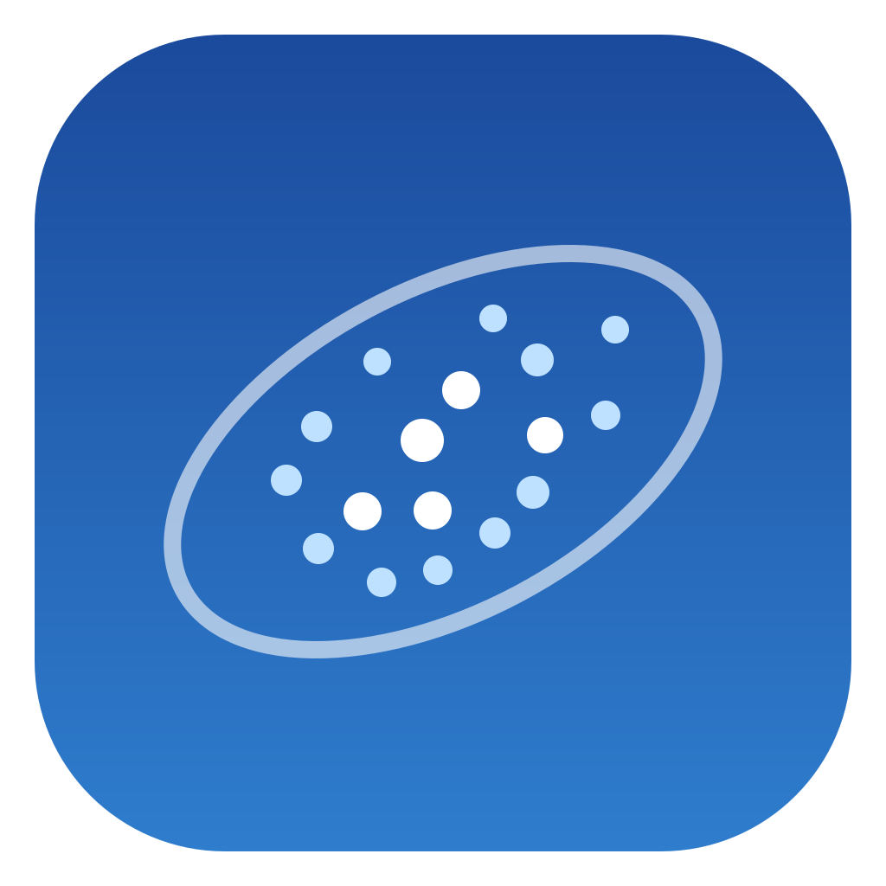
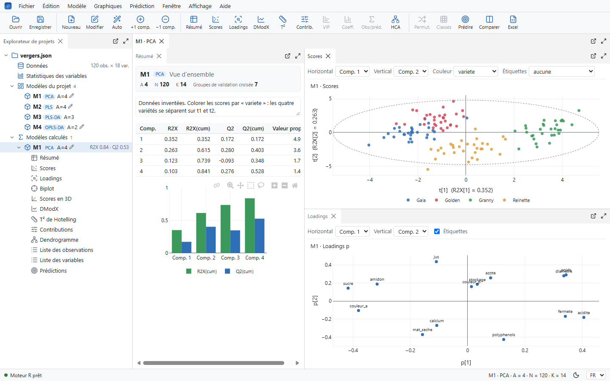
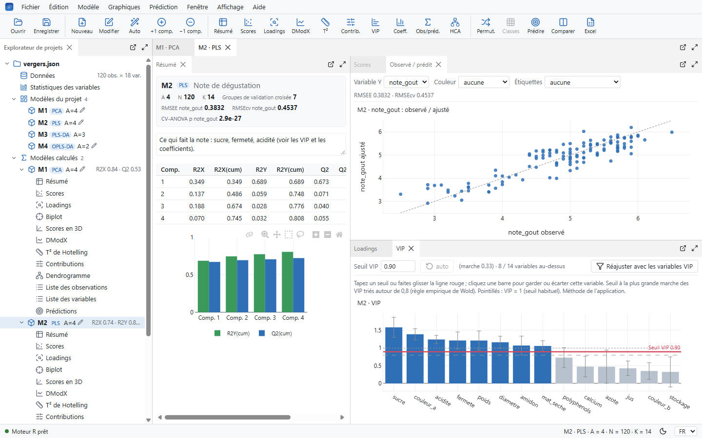
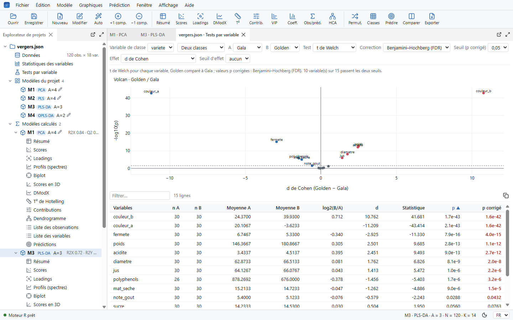
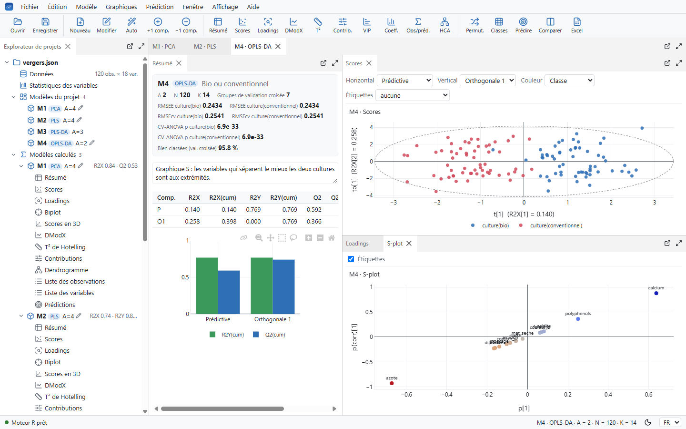
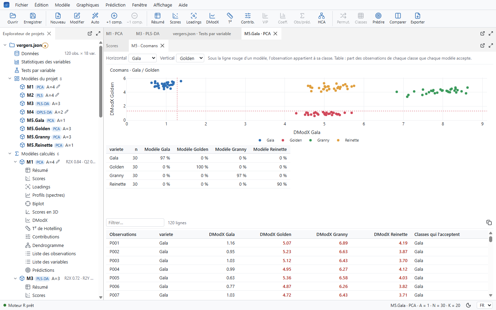
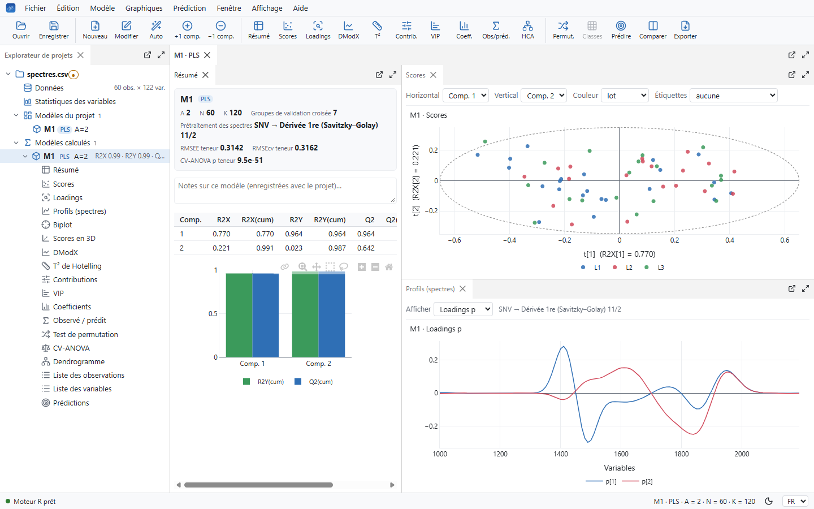
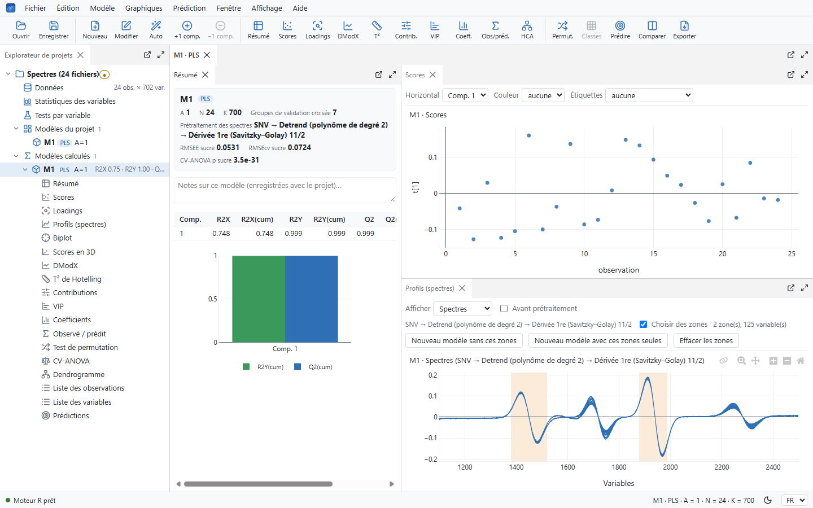
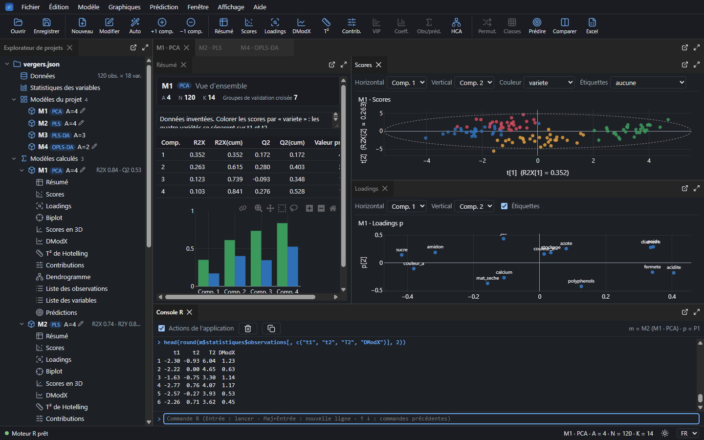

<h1 align="center">Nuée</h1>

<b>English</b> · <a href="README.fr.md">Français</a>

  <b>PCA, PLS, PLS-DA and OPLS on Windows and Linux, computed in plain R.</b> 
  Interactive plots, models side by side, and every calculation open to read.

  
  
  
  
  

Nuée (French for *swarm*) is a desktop application for multivariate data analysis. Open a
table from Excel, R, SPSS, Stata, SAS or jamovi (or paste one), pick your variables, and get
the model with its scores, loadings, diagnostics and validation, in plots you can zoom, select
and colour. Send the data and the results back to any of those programs, take the paragraph
for your Methods section, or export a script or an R Markdown / Quarto report that refits the
model in plain R, without Nuée. Every calculation is written in R, with comments, so you can
check exactly what was computed, and change it.

The interface is in English and French (*View › Language*); the screenshots show it in
French.

## Install

### Windows

1. Download `Nuee-Setup-<version>.exe` from the [Releases](https://github.com/4rtefakt/nuee/releases) page.
2. Run it and choose to install for yourself (no administrator rights needed) or for everyone
   on the computer.
3. Windows may say it protected your PC, because the installer isn't signed: click
   *More info*, then *Run anyway*.

R is included: there is nothing else to install. Nuée appears in the Start menu, and can be
uninstalled from *Settings › Apps*. Your projects stay where you saved them.

At start-up it asks GitHub whether a newer version exists (nothing else is sent). If there is
one, a click in the status bar downloads its installer, checks it against the SHA-256 checksum
GitHub gives, offers to save your projects, installs it and starts Nuée again. *Help › Look for
a new version at start-up* turns the check off.

**For IT departments:** silent installation for one user or the whole computer, a policy that
turns the update check off for everyone, what Nuée writes where and sends over the network:
[docs/deploiement.md](docs/deploiement.md).

### Linux

On Linux, Nuée uses the R installed on the computer (an R build is tied to its distribution's
libraries, so it can't be carried along as on Windows).

- **Debian, Ubuntu and their derivatives:** download `Nuee-<version>-amd64.deb` from the
  [Releases](https://github.com/4rtefakt/nuee/releases) page and install it with
  `sudo apt install ./Nuee-<version>-amd64.deb`. apt brings R and the R packages Nuée needs.
  Nuée appears in the applications menu.
- **Other distributions:** `Nuee-<version>-x86_64.AppImage` (make it executable, then run it;
  it needs FUSE 2, the `libfuse2` package on most distributions) or
  `Nuee-<version>-x64.tar.gz` (unpack it, then run `./nuee`). Install R from your
  distribution first, then the packages, in R:
  `install.packages(c("httpuv", "jsonlite", "openxlsx", "haven", "readxl", "foreign"))`.
  On Ubuntu 24.04 and later, prefer the `.deb`: it installs the AppArmor profile Chromium's
  sandbox needs there, and an AppImage has to be started with `--no-sandbox`.

Every change is checked on GitHub with the `.deb` installed on Ubuntu 22.04 and 24.04 and
Debian 12, with their own R (4.1 to 4.3).

Opening `.usp` projects needs `python3`. Nuée looks for `Rscript` on the `PATH`, then in
`/usr/local/bin`, `/usr/bin` and `/opt/R/<version>/bin`; start it with
`RSCRIPT=/path/to/Rscript` to use another R. Settings are kept in `~/.config/Nuee`. At
start-up it asks GitHub whether a newer version exists; a click in the status bar opens its
page.

## First steps

- **Try the example:** *Help › Example project* opens 120 made-up
  apples (four varieties, organic or conventional, a dozen measurements and a tasting score)
  with four models ready: a PCA, a PLS predicting the score, a PLS-DA of the varieties and an
  OPLS-DA of the growing method.
- **Open your data:** *File › Open* (Ctrl+O) reads a table with one row per observation
  and the observation names in the first column (see [Files](#files) for the formats), or
  *File › Paste a table* (Ctrl+V) takes cells copied from any spreadsheet, or drop files on
  the window. Text columns and factors become qualitative variables you can colour by, or use
  as classes.
- **Make a model:** *Model › New model* (Ctrl+N): type, the role of each variable (X, Y
  or left out), scaling and transformation, observations to include. The number of components
  is chosen by cross-validation unless you set it.
- **Explore:** each model gets its own page with its summary, scores and loadings; add any
  other view from the *Plots* menu. Select points with a box or a lasso: the selection
  follows you in every plot of the model. Click a variable (a VIP bar, a coefficient, a point
  of the loadings or of the S-plot) to highlight it in all the model's plots.

The full user guide comes with the application (*Help › User guide › Full guide*), in
English ([USER-GUIDE.txt](USER-GUIDE.txt)) and French
([LISEZ-MOI-APPLICATION.txt](LISEZ-MOI-APPLICATION.txt)).

## What it does

**Methods:** PCA, PLS, PLS-DA, and OPLS / OPLS-DA (several Y or more than two classes give
several predictive components), with missing values handled by NIPALS and 7-fold
cross-validation in which each group is predicted by a model fitted without it, centring and
scaling included (R2, Q2, and Q2 per variable). Class models: one PCA per class, and the
Coomans plot to tell which class an observation belongs to, several, or none.

**Validation:** permutation tests, CV-ANOVA, PLS-DA classification tables and ROC curves,
jack-knife confidence intervals. A test set left out of the model and of the cross-validation
(chosen by hand, at random, or by Kennard–Stone, by class for a PLS-DA), then predicted:
RMSEP, bias, SEP and external Q2, or its classification.

**Variables:** VIP with a cut-off placed automatically (or dragged by hand), coefficients,
loadings, biplot, refit with the selected variables only. Variable statistics with suggested
log transformations, histograms and a map of missing values. Tests by variable between two
classes (Welch's or Student's t, Mann–Whitney) or across all of them (ANOVA, Kruskal–Wallis),
with the Benjamini–Hochberg correction and a volcano plot.

**Observations:** scores in 2D and 3D, Hotelling's T2 and DModX with their limits,
contribution plots explaining why an observation stands out, hierarchical clustering on the
scores, classes made from a selection.

**Spectra:** open JCAMP-DX, SPC (Galactic, Thermo) or text files, one spectrum per file or
several, with a table of sample information (contents, classes) joined by file name. SNV, MSC,
detrending, baseline removal and Savitzky–Golay smoothing or derivatives before the model.
Loadings, coefficients, VIP or the spectra themselves drawn as lines against the wavelength;
drag across them to leave wavelength ranges out of a new model, or to keep only them. iPLS
(interval PLS) fits each range of the spectrum on its own and shows which ones predict best.

**Prediction:** apply a model to new observations from a table, with flags for those outside
the model's domain, and export the results.

**Your work:**
- saving a project (`.nuee`, which opens Nuée when double-clicked) keeps its models, the layout
  of your panels, plot settings and selections;
- a recovery copy every two minutes, offered back after a crash, and undo for data changes;
- notes on each model;
- data editing and new variables from R formulas or value ranges;
- several windows, and views that pop out onto a second screen;
- plots formatted for publication (fonts, palettes, size) and exported as PNG or SVG;
- Ctrl+C on any result table copies it, ready to paste into Excel;
- *View › Find a command* (Ctrl+K): type part of a command's name instead of looking through the menus;
- a model report as PDF or Word;
- the paragraph for a Methods section, written from the model in French or English, with its
  references (*Model › Text for the Methods section*).

## Files

| | Opens | Exports |
|---|---|---|
| Excel | `.xlsx`, `.xlsm`, `.xls` (choice of sheet) | `.xlsx` (one sheet per table) |
| Text | `.csv`, `.txt`, `.tsv`: separator, decimal comma and encoding detected | `.csv`, `.tsv` |
| R | `.rds`, `.RData` (choice of table; factors and row names kept) | `.rds`, `.RData` |
| SPSS | `.sav`, `.zsav`, `.por` (value labels become categories) | `.sav` |
| Stata | `.dta` | `.dta` |
| SAS | `.sas7bdat`, `.xpt` | `.xpt` |
| jamovi | `.omv` | `.omv` |
| dBase, Weka | `.dbf`, `.arff` | `.dbf`, `.arff` |
| Spectra | `.jdx`, `.dx`, `.jcm` (JCAMP-DX), `.spc` (Galactic, Thermo), or text with one column per spectrum; several files at once with *File › Import spectra* | |
| Clipboard | cells copied from Excel, LibreOffice, Google Sheets, jamovi… | |

*File › Export data* writes the project's table; *File › Export model results* (Ctrl+E)
writes the observations (scores, T2, DModX, fitted values), the variables (loadings, VIP),
the components and the coefficients. For SPSS, Stata and SAS, variable names are made valid and
the original name becomes the variable label. SAS files use the transport format version 5,
which SAS reads with `libname xport`; dBase files are in Windows-1252, as LibreOffice and GIS
software expect. Exported files were opened in jamovi, PSPP (for SPSS), Weka, LibreOffice and
pandas (for Stata and SAS). The spectra readers were checked against the official JCAMP-DX test
files (every compression form) and the usual SPC sample files.

## R all the way down

The engine is plain R in [`moteur/R/`](moteur/R), commented in French: preprocessing, NIPALS,
cross-validation, statistics, prediction. No statistic is computed anywhere else.

- **R console** (*View › R console*, Ctrl+J): see the R code behind each action, and run
  your own in the application's session, with `m` and `p` standing for the model and project
  on screen.
- **Export to R** (*File › Export to R*): any model becomes a script, or an R Markdown
  or Quarto report, that refits it without Nuée, in plain R with no package. It holds the
  data (or reads them from a CSV next to it) and the calculation written for that model alone,
  with comments: its scaling, the NIPALS algorithm, the cross-validation, then the statistics,
  tables and plots (a PLS is about 170 lines of code). The report adds the Methods text,
  tables, plots and references, and compiles in RStudio (*Knit*) or with Quarto.
  Optionally also a `renv.lock`, the data and fitted model as `.RData`, and an RStudio project.
  The whole session can go into one script instead: the data once, then every model.
  Before writing, Nuée refits the script's models and checks that they give the same results.
- **Fix it yourself:** edit a file of the engine, type `recharger_moteur()` in the console, and
  refit.

## Opening `.usp` projects

Nuée also opens `.usp` project files: their data, the models stored in them and the values
those models were saved with. It recomputes each model in R and marks every value of the
summary as identical, close or different. On 944 models from 133 projects, R2X, R2Y, scores,
loadings, T2, DModX, VIP and coefficients match the stored values, apart from a few models with
missing data; *Help › Results and known differences* lists the known differences. Q2 is
Nuée's own: its cross-validation refits each group's model without it, scaling included,
which the stored values didn't do. The two agree for large data sets (a median difference of
0.003 for PLS models with over 200 observations) and part with fewer observations, where
Nuée's Q2 is lower (0.11 lower in median from 20 to 50 observations, 0.27 up to 20). RMSEcv,
CV-ANOVA and the cross-validated classification follow.

## Reporting a problem

Open an [issue](https://github.com/4rtefakt/nuee/issues/new/choose), in English or French. *Help ›
Diagnostic information* gives the versions of Nuée, R and its packages to paste into it (no
paths, no data).

## Citing Nuée

*Model › Text for the Methods section* cites Nuée and the methods for you. Otherwise:

> 4rtefakt (2026). Nuée (version 1.0.0) [Computer software]. https://github.com/4rtefakt/nuee

GitHub's *Cite this repository* button gives it in other formats ([CITATION.cff](CITATION.cff)).
What changed in each version: [CHANGELOG.md](CHANGELOG.md).

## Building from source

See [docs/developpement.md](docs/developpement.md): running from the sources, the build
(installer and network-share version), the checks, and how the results were compared. The
checks run on GitHub for every push and pull request.

## License

Nuée is free software under the [GNU General Public License v3.0](LICENSE) or later.

The installer bundles R (GPL-2 | GPL-3) with its recommended packages and the R packages
httpuv, jsonlite, openxlsx, haven, readxl and their dependencies, Electron (MIT), Plotly.js (MIT),
dockview (MIT) and Lucide icons (ISC), each under its own license.
